If you like the Dashboard you can support me https://buymeacoffee.com/gandizzle

# Homelab Rack Dashboard

A touch dashboard for a **1280×400 rack display** in a 10-inch homelab rack: live firewall blocks on a
world map, CrowdSec bans, WAN traffic, temperatures, SMART data, backups, a vulnerability check with
**scan and patch buttons** – and a PWM-controlled rack fan, all driven by a Raspberry Pi.

I use the following Display, that fits just perfectly in a 10" Rack
https://link.amazon/B0fshQPfO
(**Affiliate Disclosure:**
The Amazon link above is an affiliate link.
As an Amazon Associate I earn from qualifying purchases)

No Grafana, no build step, no framework: one static page that reads Prometheus and Loki through a
read-only proxy. English and German UI included.

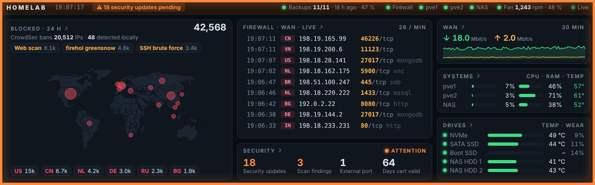

> All screenshots show the bundled **demo server** with made-up data – try it yourself in one minute,
> see [Try it without any hardware](#try-it-without-any-hardware).

## Features

- **Overview at a glance** – blocked connections (24 h) on a world map with live pulses, the live
  firewall log, WAN up/down, CPU/RAM/temperature of your hosts, drive temperatures and wear,
  backup and fan status in the header.
- **Alarms you notice from across the room** – an orange or blinking red frame plus a short text when
  a host is down, a disk reports SMART errors, backups are outdated, the fan stopped or the security
  check finds something. Tap the text to jump to the right page.
- **Tap any tile for details** – 7 detail pages with 6 h / 24 h / 7 day ranges; they return to the
  overview automatically after 60 s.
- **Security check with buttons** – pending (security) updates per system, Nuclei findings, what the
  internet sees of your connection, certificate expiry. *Start scan* and *Patch vulnerabilities* with a
  confirmation dialog that lists exactly which packages will be upgraded on which systems.
- **Rack fan control** – a Noctua 5 V PWM fan on the Pi's GPIO follows the hottest server CPU,
  reports its speed and raises an alarm if it stops.
- **Configurable** – one `config.js` for names, hosts, PromQL queries, thresholds and language
  (`en`/`de`, more can be added in `i18n.js`). Parts you don't have (fan, backups, scanner) can be
  switched off.

| | | |
|---|---|---|
| 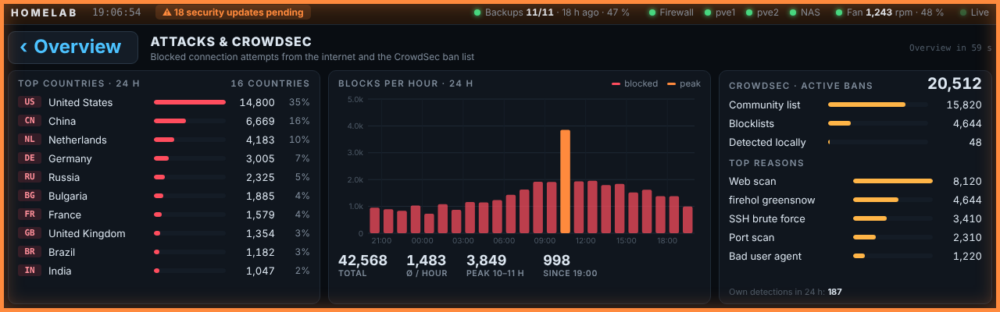 **Attacks & CrowdSec** | 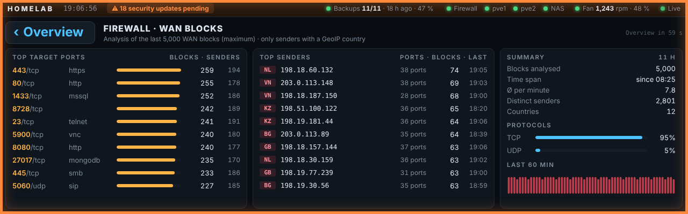 **Firewall blocks** | 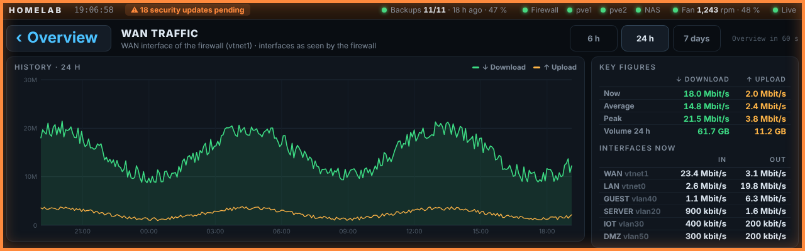 **WAN traffic** |
| 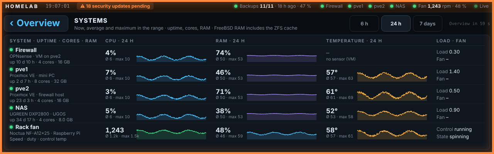 **Systems & fan** | 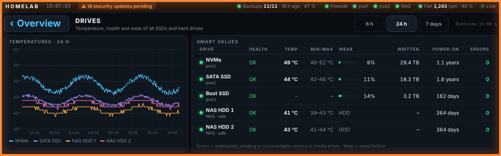 **Drives (SMART)** | 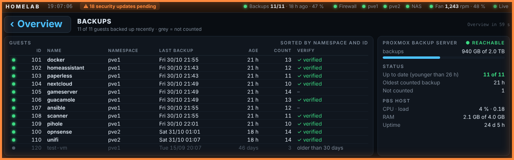 **Backups (PBS)** |
| 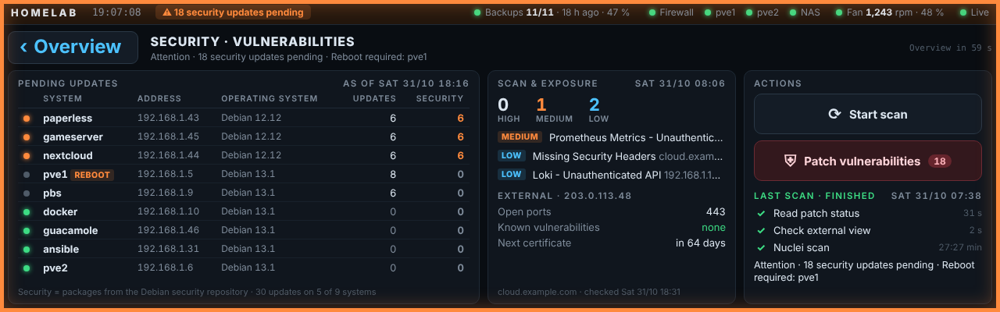 **Security check** | 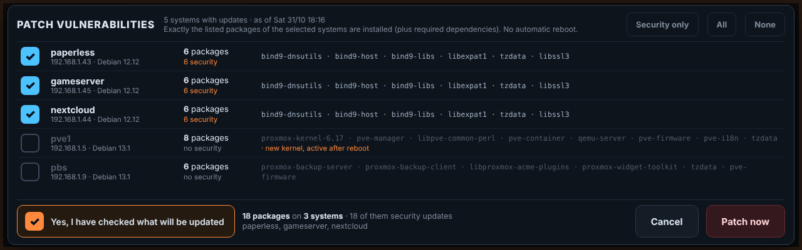 **Patch confirmation** | 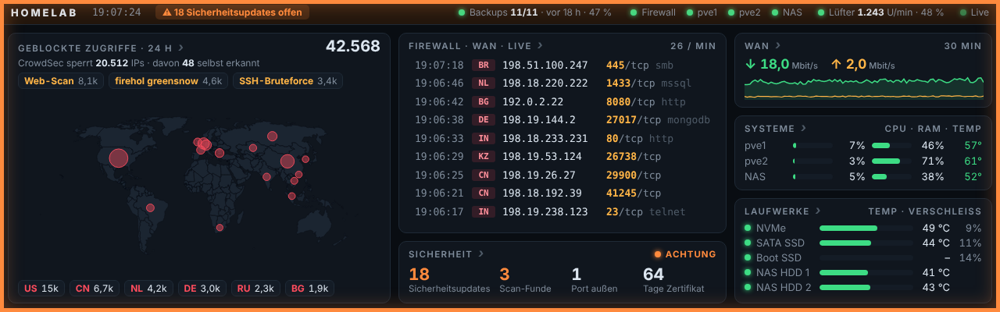 **German UI** |

## How it works

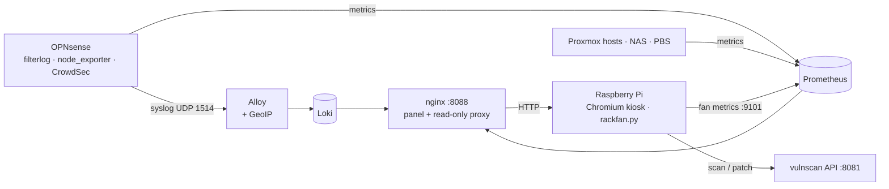

| Folder | What |
|---|---|
| [`panel/`](panel) | the dashboard (`html/`), its nginx container and a [demo server](panel/demo/demo-server.py) |
| [`monitoring/`](monitoring) | Docker Compose: Prometheus, Loki, Alloy with GeoIP, opnsense-exporter |
| [`exporters/`](exporters) | node_exporter/SMART for Proxmox and the NAS, PBS exporter, [OPNsense setup](exporters/opnsense/README.md) |
| [`raspberry-pi/`](raspberry-pi) | kiosk autostart and the fan controller `rackfan.py` |
| [`vulnscan/`](vulnscan) | Ansible playbooks for the vulnerability scanner and the scan/patch API |
| [`docs/`](docs) | [setup guide](docs/setup.md), [hardware](docs/hardware.md), [configuration](docs/configuration.md), [architecture](docs/architecture.md), [troubleshooting](docs/troubleshooting.md) |

## Try it without any hardware

Needs only Python 3:

```sh
git clone https://github.com/gandizzle91/homelab-rack-dashboard.git
cd homelab-rack-dashboard
python3 panel/demo/demo-server.py          # add --lang de for German
```

Open <http://localhost:8099> – ideally in a 1280×400 window. Everything is clickable, and the scan and
patch buttons "work" against fake data.

## Build your own

The full step-by-step guide is in **[docs/setup.md](docs/setup.md)**. In short:

1. **Monitoring stack** on any Docker host: `monitoring/` (fill in `.env`, adjust `prometheus.yml`).
2. **Exporters** on your hosts: `exporters/` – and the [OPNsense settings](exporters/opnsense/README.md)
   for syslog, node_exporter and CrowdSec.
3. **Panel**: edit `panel/html/config.js`, then `docker compose up -d` in `panel/`.
4. **Raspberry Pi** with the display: kiosk autostart from `raspberry-pi/`.
5. Optional: **rack fan** ([wiring](docs/hardware.md#fan-wiring)) and the **vulnerability scanner**
   ([vulnscan/README.md](vulnscan/README.md)).

You don't need everything: without CrowdSec, PBS, the fan or the scanner the corresponding parts stay
empty or can be switched off in `config.js`.

### What it was built for

| Part | Used here | Should also work with |
|---|---|---|
| Firewall | OPNsense VM on Proxmox | OPNsense on bare metal (change `WAN_IF`); pfSense uses the same filterlog format but is untested |
| Hosts | 2× Proxmox VE 9 mini PCs, UGREEN DXP2800 NAS | anything with node_exporter |
| Display | GeeekPi/DeskPi DP-0059 (7.84″, 1280×400, touch) on a Raspberry Pi 4B | any 1280×400 screen; other sizes are scaled to fit |
| Updates | Debian 12/13 systems via Ansible | Debian/Ubuntu (the patch feature uses `apt`) |

## Security

Read **[SECURITY.md](SECURITY.md)** before you deploy. The most important points:

- Keep the panel, Prometheus, Loki and the scanner **inside your LAN**. Never expose them to the
  internet – the panel has no login.
- The patch button installs updates on your servers. Only the devices listed in `control_clients`
  may press it (by default only the Pi), and it only upgrades packages that are already installed.
- Secrets (API keys, tokens, passwords) belong in `.env` files only. They are ignored by git.

## Credits

- Map: [Natural Earth](https://www.naturalearthdata.com/) (public domain) via
  [world-atlas](https://github.com/topojson/world-atlas) (ISC licence).
- IP geolocation: [MaxMind GeoLite2](https://dev.maxmind.com/geoip/geolite2-free-geolocation-data) –
  downloaded by you with your own free account; the database is not part of this repository.
- Built on [Prometheus](https://prometheus.io/), [Grafana Loki and Alloy](https://grafana.com/oss/),
  [opnsense-exporter](https://github.com/AthennaMind/opnsense-exporter),
  [pbs-exporter](https://github.com/natrontech/pbs-exporter),
  [CrowdSec](https://www.crowdsec.net/), [Nuclei](https://github.com/projectdiscovery/nuclei) and
  [Shodan InternetDB](https://internetdb.shodan.io/).
- Code and documentation were written with the help of an AI assistant (Claude by Anthropic) and
  reviewed and run in a real homelab.

## Status

Runs 24/7 in the author's homelab. This public, translated release was tested with the bundled demo
server and syntax-checked; if something does not work in your setup, please open an issue.

## License

[MIT](LICENSE) – use it, change it, share it. No warranty: in particular the patch feature changes
software on your servers, so test it carefully.

If you like the Dashboard you can support me https://buymeacoffee.com/gandizzle
