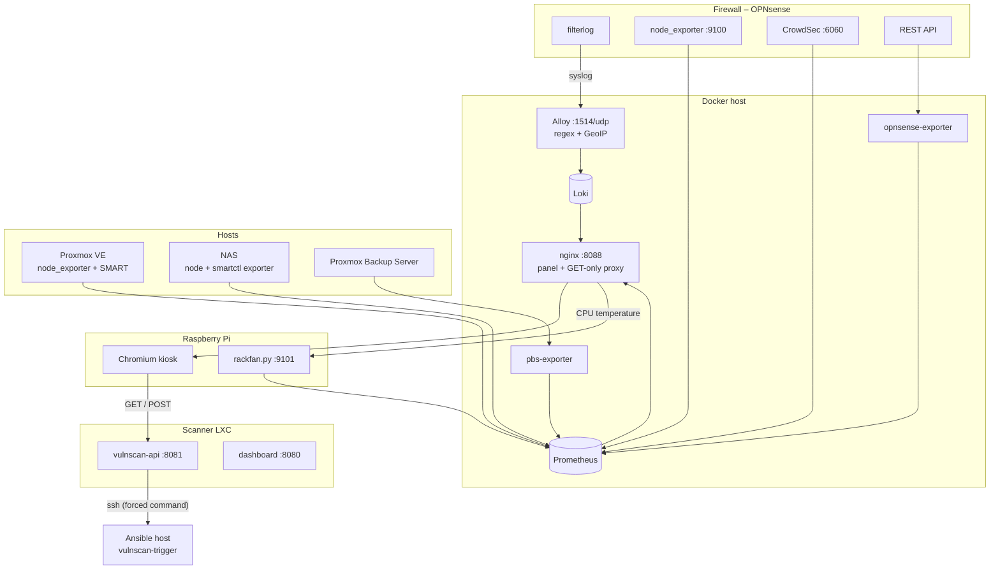

# Architecture

## Data flow

**Firewall log.** OPNsense sends every `filterlog` line via syslog (RFC5424, UDP) to Alloy. Alloy
extracts interface, action, direction, protocol, source/destination IP and ports with a regular
expression, adds GeoIP data (country, city, coordinates) for the source IP and stores everything in
Loki as *structured metadata* – queryable, but without creating thousands of label values. Only IPv4
is parsed; IPv6 lines are stored unparsed.

**Metrics.** Prometheus scrapes node_exporter on all hosts (CPU, RAM, temperatures, SMART via the
textfile collectors), the opnsense-exporter (interfaces), CrowdSec, the PBS exporter and the fan.

**Panel.** A single static page (`index.html`, `config.js`, `i18n.js`, `map-data.js`, `app.js`)
served by nginx. It queries the Prometheus and Loki HTTP APIs directly from the browser through
nginx, which only allows `GET`. Refresh intervals: log 5 s, metrics 10 s, WAN chart and CrowdSec
30 s, map and backups 60 s, security 60 s (3 s while a job runs). Detail pages refresh every 30 s.

**Map.** The world outlines are pre-projected (Natural Earth projection) into a single SVG path in
`map-data.js`; `project()` in `app.js` uses the same formula for the dots. Live blocks pulse at their
GeoIP coordinates, the 24-hour totals are circles per country centroid.

**Security.** The browser talks to the vulnscan API on the scanner directly (CORS). Reading is open
in the LAN; scan and patch requests are only accepted from `CONTROL_CLIENTS` and with a private
`Origin`. See [vulnscan/README.md](../vulnscan/README.md) for the chain scanner → Ansible host.

**Fan.** `rackfan.py` reads the hottest CPU temperature through the panel's proxy (so Prometheus
can stay bound to localhost), sets the 25 kHz hardware PWM and counts tachometer pulses with
`lgpio`. Prometheus scrapes its metrics like any other exporter.

## Why no Grafana?

Grafana is great on a desktop, but its dashboards are made for large screens and a mouse. On a
1280×400 touch strip a purpose-built page can use every pixel, offer big touch targets and combine
data that lives in different places (Prometheus, Loki, the scanner API). Grafana can still run next
to it on the same data (`docker compose --profile grafana up -d`).
