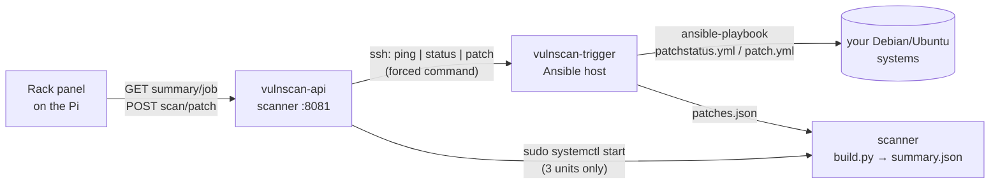

# vulnscan – automatic security check for the homelab

A small, self-hosted vulnerability check that feeds the **Security** tile of the rack panel and
adds two buttons to it: **Start scan** and **Patch vulnerabilities** (with a confirmation dialog).

| Check | Where | When |
|---|---|---|
| **Patch status** – pending updates, how many are security updates, reboot required? | Ansible host, all systems in your inventory | daily 06:15 + "Start scan" |
| **Nuclei** – known vulnerabilities and misconfigurations of your web UIs | scanner container | Sunday 03:30 + "Start scan" |
| **External view** – what the internet sees of your connection (Shodan InternetDB), certificate expiry | scanner container | daily 06:45 + "Start scan" |
| **Dashboard** – detailed web page | scanner, port 8080 | always |
| **API** – data and buttons for the rack panel | scanner, port 8081 | always |



## Requirements

* An **Ansible host** that can already reach all your systems with `ansible -m ping all`
  (root or `become`). The patch features use `apt`, so **Debian/Ubuntu** systems only.
* A **Proxmox VE** host for the scanner container (amd64), listed in the same inventory.
* Ansible ≥ 2.14 on the Ansible host.

## Installation

```sh
# on the Ansible host
git clone https://github.com/<you>/homelab-rack-dashboard.git
cd homelab-rack-dashboard/vulnscan
nano vars.yml              # IPs, inventory path, DDNS name, which device may press the buttons
nano files/targets.txt     # URLs to scan – only systems you own
nano files/domains.txt     # domains for the certificate check

LC_ALL=C.UTF-8 ansible-playbook -i /root/ansible/inventory.yml scanner.yml -e @vars.yml
LC_ALL=C.UTF-8 ansible-playbook -i /root/ansible/inventory.yml buttons.yml -e @vars.yml
```

`scanner.yml` creates the container `vulnscan` on `pve_host`, installs Nuclei, the external
check and the dashboard, schedules the daily patch status and collects it once.
`buttons.yml` adds the API and the SSH trigger and tests that the restrictions work.
Both are safe to run again: an existing container is kept, `targets.txt` and `domains.txt`
on the scanner are never overwritten.

Then point the panel at the API in `panel/html/config.js`:

```js
vuln: 'http://192.168.1.30:8081/api',
```

If the scanner has to reach systems in other VLANs, allow it in your firewall
(e.g. an OPNsense alias `vulnscan` with a rule from the scanner to the target ports).

## How the buttons are secured

The patch button installs software on your servers, so it is locked down in layers:

1. **Who may press** – the API accepts `POST` only from addresses in `CONTROL_CLIENTS`
   (`control_clients` in `vars.yml`, default: only the rack display's Pi). Everyone else sees the
   page with greyed-out buttons.
2. **No cross-site requests** – a `POST` must come from a page with a private address
   (`Origin` check), so a malicious website opened on the Pi cannot trigger anything.
3. **What can be installed** – the display only sends the *names* of the selected hosts and the
   id of the patch plan it showed. The scanner looks up the packages in its own stored patch status;
   if the plan changed in the meantime, the request is rejected and the dialog reloads.
4. **What the scanner may do on the Ansible host** – its SSH key is restricted with
   `command="/usr/local/sbin/vulnscan-trigger",from="<scanner ip>",restrict`. The trigger knows
   only `ping`, `status` and `patch`, checks every host against the inventory and every package
   name against a strict pattern.
5. **How it installs** – `apt` with `only_upgrade: true` for exactly the listed packages
   (plus required dependencies). No new software, **no automatic reboot**.
6. **On the scanner** – the API runs as its own unprivileged user; `sudo` allows only starting the
   three vulnscan units.

Still: anyone with physical access to the display can patch your systems. If that is not
acceptable, set `control_clients: []` – the tile then shows data only.

## Traffic light

| Status | When |
|---|---|
| **Critical** | high/critical Nuclei findings, known vulnerabilities visible from outside, a certificate expires in < 7 days |
| **Attention** | pending security updates, reboot required, a system not reached, medium findings, certificate < 14 days or not checkable |
| **All good** | otherwise |

## Day-to-day

On the scanner:

```sh
systemctl start vulnscan-nuclei.service      # run Nuclei now
systemctl start vulnscan-external.service    # check the external view now
journalctl -u vulnscan-nuclei -f             # watch Nuclei
systemctl list-timers 'vulnscan*'            # next runs
journalctl -u vulnscan-api -f                # API log
ls /var/lib/vulnscan-api/logs/               # full log of every scan/patch run
```

Allow another device to use the buttons: add it to `control_clients` and run `buttons.yml`
again, or edit `/etc/default/vulnscan-api` on the scanner and `systemctl restart vulnscan-api`.

## Files on the scanner

| Path | Content |
|---|---|
| `/opt/vulnscan/data/patches.json` | patch status from the Ansible host |
| `/opt/vulnscan/data/nuclei.jsonl` | raw results of the last Nuclei run |
| `/opt/vulnscan/data/external.json` | external view |
| `/opt/vulnscan/www/data/summary.json` | summary read by the dashboard and the API |

## API

| Method | Path | |
|---|---|---|
| `GET` | `/api/summary` | the summary (`status`, `reasons`, `reason_codes`, `patches`, `nuclei`, `external`) |
| `GET` | `/api/job` | `{control, running, job}` – the running or last job with its steps |
| `POST` | `/api/scan` | start patch status + external view + Nuclei |
| `POST` | `/api/patch` | `{"plan": "<patches.generated>", "hosts": ["paperless"], "confirm": true}` |

Errors: `{"error": "<English text>", "code": "<id>"}` – e.g. `busy`, `stale`, `control_denied`.

## Uninstall

* Proxmox host: `pct stop <id> && pct destroy <id>`
* Ansible host: `crontab -e` (remove the `vulnscan-patchstatus` line), remove the line ending in
  `vulnscan-api` from `/root/.ssh/authorized_keys`,
  `rm /usr/local/sbin/vulnscan-trigger /etc/default/vulnscan-trigger`
* Panel: `vuln: null` in `config.js`
